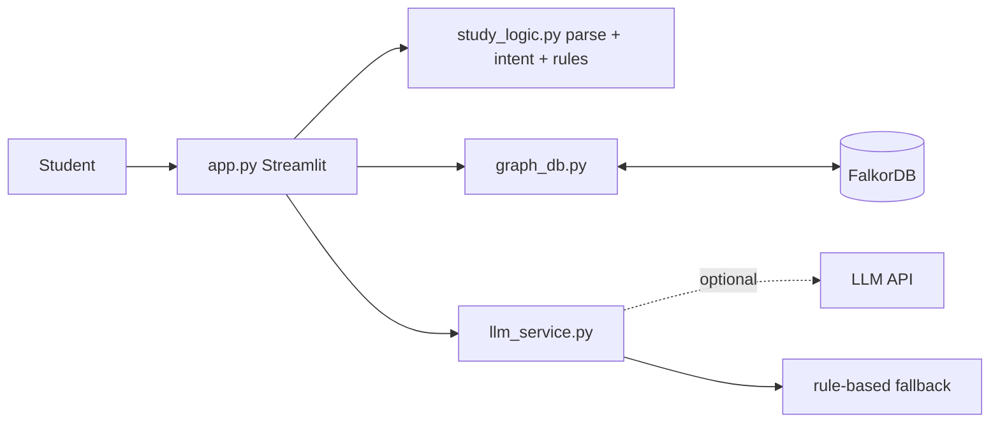

# 🧠 StudyMate AI: An AI Study Assistant with Persistent Memory

Hackathon: Graph Hacks / FalkorDB · Track 02 — Agent Memory and Coordination

StudyMate AI lets a student say what they studied and what was hard. It stores that in a **FalkorDB graph**, retrieves it in later conversations, and recommends what to revise next with a short plan and practice questions.

## Problem and users
Students forget what they found difficult and re-study what they already know. Chat assistants lose context between sessions. Target users: self-learners and students (e.g. learning Python) who want personalised revision.

## Features
- Chat UI (Streamlit) with sidebar of weak/understood topics, latest recommendation, and a memory-graph view.
- Natural-language study reports are parsed (rule-based) into subject, topic, understood and difficult items.
- Persistent memory in FalkorDB, isolated per student ID.
- "What should I study next?" queries the graph, explains the choice from real stored memories, and gives a plan + 5 practice questions.
- Optional LLM phrasing (Anthropic API). Without a key, or if the call fails, a **clearly labelled rule-based fallback** is used. Every reply shows what generated it.
- Connection status indicators and a friendly screen when FalkorDB is down.
- Separate, optional **Demo student** mode so sample data never mixes with real data.

## Architecture



Data flow: message → intent detection → **record** (parse → Cypher MERGE/CREATE) or **recommend** (Cypher reads → rule-based plan → optional LLM rewording of that plan using only the retrieved memories).

The LLM does **not** extract data or store anything; extraction is deterministic. This is a single-app design, not a multi-agent system.

## Why a graph?
Study knowledge is relational: subjects contain topics, sessions cover topics, students struggle with topics. A graph lets us traverse "topics the student already understands in the same subject as the one they struggle with" in one query, and lets the memory grow naturally without schema changes.

## Graph schema
See [assets/graph_model.md](assets/graph_model.md).

Nodes: `Student`, `Subject`, `Topic`, `StudySession`. Relationships: `STUDIES`, `CONTAINS`, `COMPLETED`, `COVERS`, `STRUGGLES_WITH`, `UNDERSTANDS`. Uniqueness constraints on `Student.sid`, `Subject.name`, `Topic.key`, `StudySession.id`.

## Cypher used by the implementation
All queries are parameterised (copied from `graph_db.py`).

**`Q_UPSERT_SESSION`**
```cypher
MERGE (st:Student {sid: $sid})
  ON CREATE SET st.created = $now
MERGE (sub:Subject {name: $subject})
MERGE (st)-[:STUDIES]->(sub)
CREATE (s:StudySession {id: $session_id, date: $now, notes: $notes, subject: $subject})
MERGE (st)-[:COMPLETED]->(s)
```

**`Q_COVER_TOPIC`**
```cypher
MATCH (s:StudySession {id: $session_id}), (sub:Subject {name: $subject})
MERGE (t:Topic {key: $key})
  ON CREATE SET t.name = $topic, t.subject = $subject
MERGE (sub)-[:CONTAINS]->(t)
MERGE (s)-[c:COVERS]->(t)
SET c.outcome = $outcome, c.difficulty = $difficulty
```

**`Q_MARK_STRUGGLE`**
```cypher
MATCH (st:Student {sid: $sid}), (t:Topic {key: $key})
MERGE (st)-[r:STRUGGLES_WITH]->(t)
  ON CREATE SET r.reports = 1, r.first_reported = $now
  ON MATCH SET r.reports = r.reports + 1
SET r.difficulty = $difficulty, r.last_reported = $now
```

**`Q_MARK_UNDERSTOOD`**
```cypher
MATCH (st:Student {sid: $sid}), (t:Topic {key: $key})
MERGE (st)-[u:UNDERSTANDS]->(t)
SET u.last_reported = $now
```

**`Q_RESOLVE_STRUGGLE`**
```cypher
MATCH (:Student {sid: $sid})-[r:STRUGGLES_WITH]->(:Topic {key: $key})
DELETE r
```

**`Q_WEAK_TOPICS`**
```cypher
MATCH (:Student {sid: $sid})-[r:STRUGGLES_WITH]->(t:Topic)
RETURN t.name, t.subject, r.difficulty, r.reports, r.last_reported
ORDER BY r.difficulty DESC, r.reports DESC, r.last_reported DESC
```

**`Q_UNDERSTOOD_TOPICS`**
```cypher
MATCH (:Student {sid: $sid})-[u:UNDERSTANDS]->(t:Topic)
RETURN t.name, t.subject, u.last_reported
ORDER BY u.last_reported DESC
```

**`Q_RECENT_SESSIONS`**
```cypher
MATCH (:Student {sid: $sid})-[:COMPLETED]->(s:StudySession)-[c:COVERS]->(t:Topic)
RETURN s.id, s.date, s.notes, t.name, t.subject, c.outcome
ORDER BY s.date DESC
LIMIT $limit
```

**`Q_RELATED_UNDERSTOOD`**
```cypher
MATCH (:Student {sid: $sid})-[:UNDERSTANDS]->(known:Topic)<-[:CONTAINS]-(sub:Subject)-[:CONTAINS]->(weak:Topic {key: $key})
RETURN DISTINCT known.name
```

**`Q_STUDENT_GRAPH`**
```cypher
MATCH (st:Student {sid: $sid})-[:STUDIES]->(sub:Subject)-[:CONTAINS]->(t:Topic)
OPTIONAL MATCH (st)-[r:STRUGGLES_WITH]->(t)
OPTIONAL MATCH (st)-[u:UNDERSTANDS]->(t)
RETURN sub.name, t.name, r IS NOT NULL AS struggling, u IS NOT NULL AS understood
```

**`Q_STUDENT_COUNTS`**
```cypher
MATCH (st:Student {sid: $sid})
OPTIONAL MATCH (st)-[:COMPLETED]->(s:StudySession)
RETURN count(DISTINCT s)
```

**`Q_CLEAR_STUDENT`**
```cypher
MATCH (st:Student {sid: $sid})
OPTIONAL MATCH (st)-[:COMPLETED]->(s:StudySession)
DETACH DELETE s, st
```


## Setup
```bash
python -m venv .venv && source .venv/bin/activate   # Windows: .venv\Scripts\activate
pip install -r requirements.txt
cp .env.example .env                                # Windows: copy .env.example .env
```

## Start FalkorDB
Local with Docker:
```bash
docker run -p 6379:6379 -it --rm falkordb/falkordb:latest
```
Cloud: create your own instance, then put its host, port, username, password in `.env` (set `FALKORDB_SSL=true` if your instance requires TLS). Use only instances you are authorised to use.

## Run the app
```bash
streamlit run app.py
```

## Configure the LLM (optional)
Set `ANTHROPIC_API_KEY` (and optionally `LLM_MODEL`) in `.env`. Never commit `.env`. Without a key the app uses the rule-based fallback and says so in the UI.

## Run tests
```bash
pytest -q
```
The unit tests need no database. One graph integration test runs only if FalkorDB is reachable at the configured host/port (it uses a separate `studymate_test` graph) and is skipped otherwise.

## Verification status (honest report)
- ✅ Unit tests for parsing, intents, recommendations, fallback labelling: passed.
- ✅ `graph_db.py` Cypher and the Streamlit UI flow were exercised against an **embedded FalkorDB engine (falkordblite)** in the build sandbox: saving, retrieval, de-duplication, constraints, student isolation, resolve-on-understood, recommendation. 
- ⚠️ Not verified: running against a Docker/cloud FalkorDB **server** over TCP (no Docker in the sandbox), and live LLM calls (no API key). The code path uses the standard `falkordb` client, but please run the checklist below on your machine.
- ⚠️ Not deployed anywhere.

## Known limitations
- Extraction is rule-based English patterns and a fixed subject list; unusual phrasing may be missed (unknown subjects become "General").
- No authentication; the student ID is user-chosen.
- Practice questions are templates in fallback mode.
- Recommendation ranks by difficulty, then report count, then recency.

## Demo video
Link:https://youtu.be/ISYEpyCM_S4 

## Submission
Draft answers: [docs/submission_answers.md](docs/submission_answers.md)

## License
MIT
