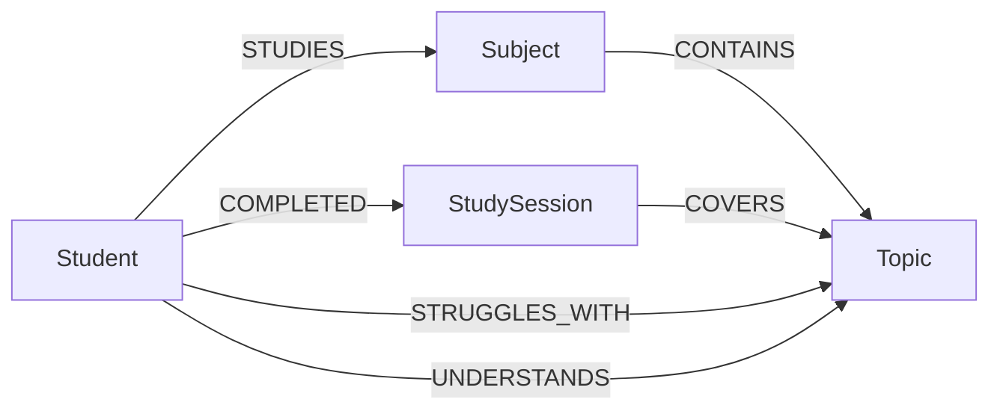

# Graph model

| Node | Key properties |
|---|---|
| `Student` | `sid` (unique), `created` |
| `Subject` | `name` (unique) |
| `Topic` | `key` (unique, `subject::topic` lowercase), `name`, `subject` |
| `StudySession` | `id` (unique), `date` (ISO UTC), `notes` (original text), `subject` |

| Relationship | Properties |
|---|---|
| `(Student)-[:STUDIES]->(Subject)` | none |
| `(Subject)-[:CONTAINS]->(Topic)` | none |
| `(Student)-[:COMPLETED]->(StudySession)` | none |
| `(StudySession)-[:COVERS]->(Topic)` | `outcome` (studied / understood / difficult), `difficulty` (0-5) |
| `(Student)-[:STRUGGLES_WITH]->(Topic)` | `difficulty` (1-5), `reports` (count), `first_reported`, `last_reported` |
| `(Student)-[:UNDERSTANDS]->(Topic)` | `last_reported` |

Rules: reporting a topic as understood deletes the `STRUGGLES_WITH` edge (the session history is kept).
Every student-facing query starts at `(:Student {sid: $sid})`, which isolates students from each other.
Subjects and topics are shared nodes; only the student-owned edges and sessions carry personal data.
